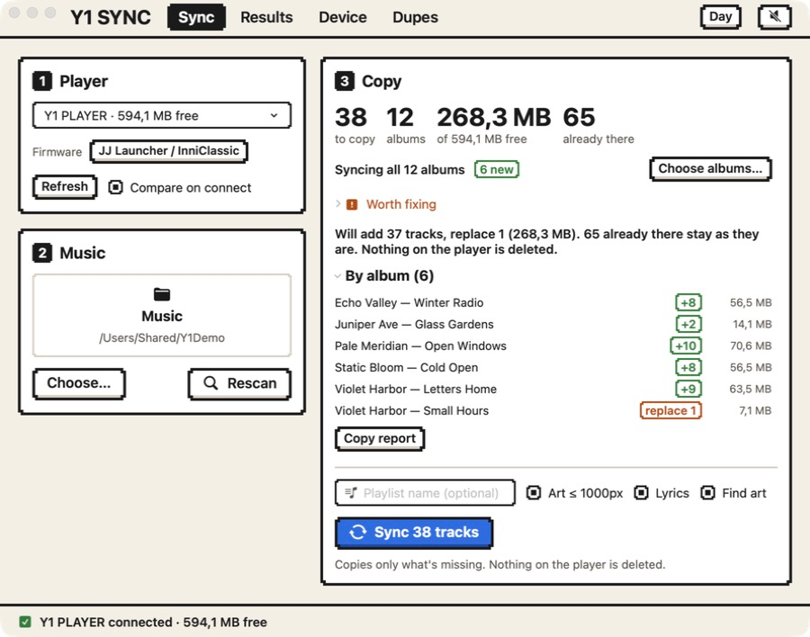
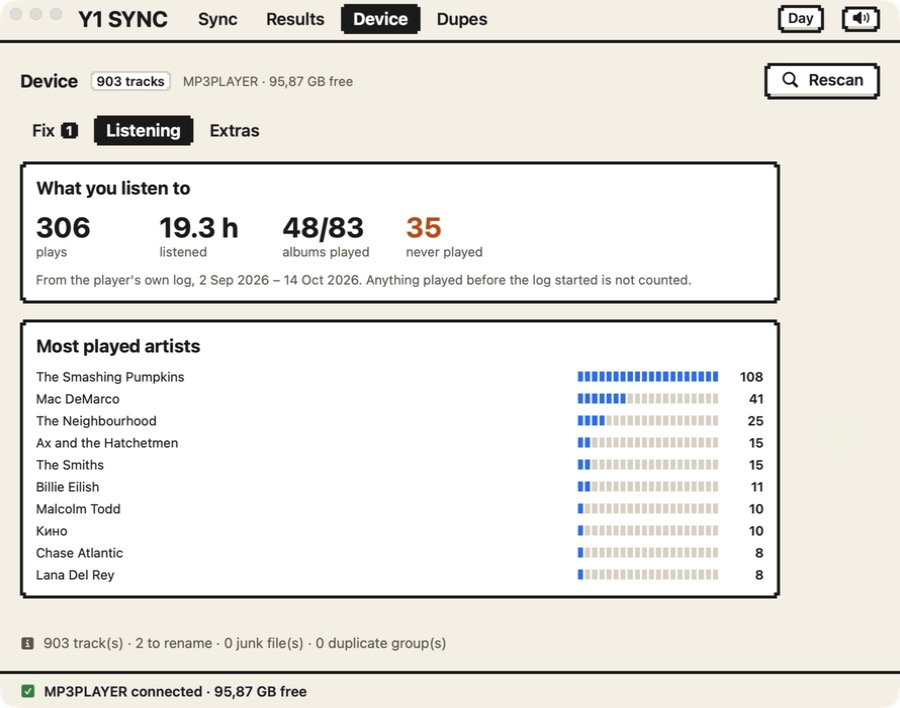
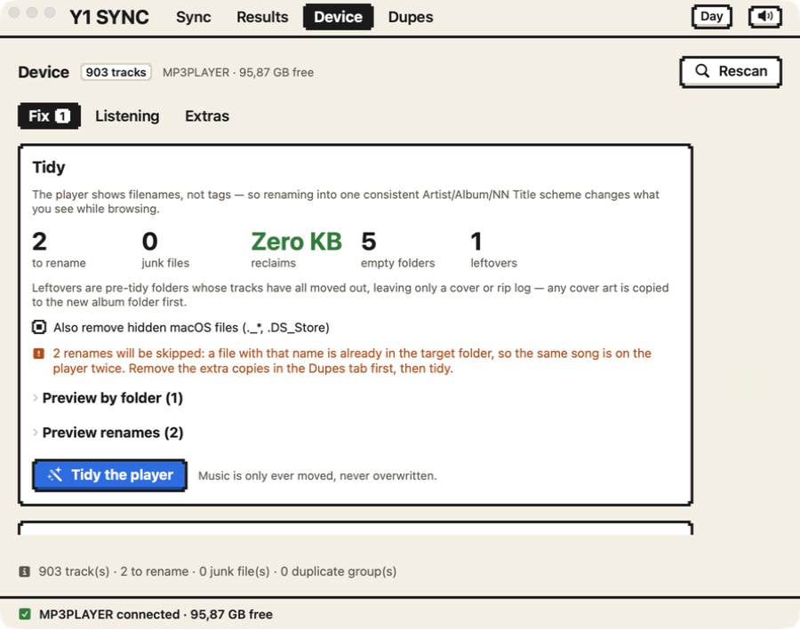

<p align="center">
  
</p>

<h1 align="center">Y1 Sync</h1>

<p align="center">
  Keep your music library on an <b>Innioasis Y1</b> in order — from your Mac.<br>
  Copies only what is missing, checks every file, fixes the mess, never deletes anything for good.
</p>

<p align="center">
  <a href="https://ko-fi.com/nerrosha"></a>
  
  
  
  
</p>

---

The Y1 shows your music from the files and tags on its card, so a card that has grown
over time turns into a mess: the same album split in two, an artist spelled two ways,
songs the player never lists, cut-off files that will not play, hundreds of megabytes
of duplicates. **Y1 Sync** is a native Mac app (and a command-line tool) that syncs a
library to the player and cleans up what is already there.

## Screenshots

<table>
  <tr>
    <td width="50%"></td>
    <td width="50%"></td>
  </tr>
  <tr>
    <td align="center"><sub><b>Sync</b> — see what will change, album by album, before anything is written</sub></td>
    <td align="center"><sub><b>Listening</b> — what you really play, from the player's own log</sub></td>
  </tr>
  <tr>
    <td colspan="2"></td>
  </tr>
  <tr>
    <td colspan="2" align="center"><sub><b>Device → Fix</b> — tidy the card, clear junk, keep the player's own song list in step</sub></td>
  </tr>
</table>

## What it does

**Sync**
- Compares your library with the player and copies **only what is missing**. Run it again and nothing is copied twice.
- Shows **what will change before anything is written** — per album, with sizes and the reason for every replacement.
- Every copied file is flushed to the card and **read back and verified** before it is put in place. A failed or interrupted copy never replaces a good file. **Stop** any time; finished files stay.
- Checks files first and skips empty, truncated and corrupt ones.
- Shrinks oversized embedded cover art on the copy (your library files are never touched) and adds synced lyrics (`.lrc`) and missing covers on request.
- Speed and time left while it runs; unchanged files are not re-read on later scans, so scanning a full card takes a fraction of a second instead of over a minute.

**Fix what is already on the player**
- **Tidy** names into one `Artist/Album/NN Title` layout and clears the hidden macOS `._*` files the player would list.
- **Albums and artists spelled twice** ("Malcom Todd" / "Malcolm Todd", "The Smashing Pumpkins" / "Smashing Pumpkins") are found and merged by changing only the tags. Merges are **remembered**, so the next sync does not copy the old spelling back.
- **Broken files**: decodes the start and end of every file, finds cut-off copies, replaces them from your library when an intact copy exists.
- **Duplicates**: the same song stored twice — one button cleans up the safe groups (same song, same album) and keeps the best copy; the rest are left for you to decide.
- The player's own **song list** is kept in step, so new files actually show up on it.

**Know your player**
- **Listening**: what you actually play, from the player's own log. Most played artists and albums, never-played albums, and **free up space** by removing the least listened — with Undo, and sync will not put them back.
- **Formats**: every format, bit depth and sample rate on the card, with optional limits for what your player cannot play.

**Safe by design**
Nothing is deleted straight away: files go to a hidden undo folder on the player, and **Undo** puts them back. Audio is **never converted or re-encoded** — only tags and cover art are rewritten, and the audio bytes stay identical.

## Works with your firmware

The Y1 runs different software. Y1 Sync looks at the card to tell which, and adapts (you can override it per player).

| | Stock Innioasis | JJ Launcher / InniClassic | Rockbox |
|---|---|---|---|
| Formats scanned | mp3 flac wav ogg opus m4a m4b aac ape wma | same | also wv mpc aiff |
| Cover size kept | 500 px | 1000 px | 500 px |
| Player's own song list kept current | – | yes (`.y1_library_cache.json`) | – |
| Play log for the Listening tab | may not exist | `.scrobbler.log` | when its scrobbler is on |

Tested on **InniClassic**. The stock and Rockbox columns come from their documentation —
the stock firmware's exact format list is not published, so it is treated like the
launcher's rather than hiding files on a guess. **Corrections and reports from other
firmware are very welcome** (see [Contributing](CONTRIBUTING.md)).

## Install

Requires macOS 14 or newer and Xcode (or the Swift 6 toolchain) to build.

```bash
git clone https://github.com/nerrosha/y1-sync.git
cd y1-sync
./build-app.sh
open "build/Y1 Sync.app"
```

`build-app.sh` produces the app and the `y1sync` command-line tool in `build/`. The app is
not notarized, so on first launch macOS may ask you to confirm (right-click → Open).

**The player does not mount until you enable USB storage on the player itself** — this is
the usual reason nothing shows up.

## Using it

1. Connect the player (USB storage on), open the app, pick your music folder.
2. **Scan and compare** — see exactly what would change.
3. **Sync** — or fix things first on the **Device** tab.

| Tab | What it is for |
|---|---|
| **Sync** | Choose player and folder, see the plan, copy. |
| **Results** | Every copied file, with what was fixed; play it straight off the player. |
| **Device** | Fix (tidy, merges, broken files, formats), Listening, Extras (lyrics, covers, smart playlists). |
| **Dupes** | Duplicates, with one-click clean-up of the safe ones. |

### Command line

```bash
y1sync devices                     # connected players
y1sync plan  ~/Music               # dry run: what would be copied
y1sync sync  ~/Music               # copy
y1sync check ~/Music               # broken files, huge covers, tag problems
y1sync tidy [--apply]              # tidy what is on the player (dry run by default)
y1sync health [--repair]           # find files on the player that will not play
y1sync artists | albums            # names spelled twice
y1sync formats                     # formats on the card, firmware, scan speed
y1sync listening                   # what you play, from the player's log
y1sync undo [--apply]              # restore the last cleanup
```

Run `y1sync help` for all commands and options.

<details>
<summary><b>How it works, and why</b></summary>

- **Plain files.** The Y1 mounts as USB mass storage, so this is ordinary file access to `/Volumes/<name>` — no drivers.
- **FAT32.** Names are normalised for FAT (forbidden characters, trailing dots, reserved names) and compared case-insensitively, otherwise every sync would re-copy the whole library.
- **FLAC and M4A are parsed directly**, because the system tag API does not expose Vorbis comments. Tag edits stream the audio through untouched.
- **"Already there" is decided by the audio**, not the file size: tags are rewritten on the way across, so a correctly synced file is almost never the same size as its source.
- **macOS litter.** Writing to FAT creates hidden `._name` files that macOS hides from itself but the player lists. They are found by probing sibling paths.
- **Broken files** are caught by decoding, not by headers: random bytes contain valid MP3 frame syncs. The ends of FLAC files are checked cheaply from the frame headers.
- **Scan cache.** Per file, size and modification time decide whether tags and health are read again (stored on your Mac, never on the player).
- **Online lookups are opt-in**: lyrics from [LRCLIB](https://lrclib.net), covers from the [Cover Art Archive](https://coverartarchive.org). They send artist, album and track names to those services.

</details>

<details>
<summary><b>For developers</b></summary>

```
Sources/Y1SyncCore/    engine — no UI, fully tested
Sources/y1sync/        command-line tool
Sources/Y1SyncAppUI/   SwiftUI views and models
Sources/Y1SyncApp/     thin executable that launches the UI
Tests/                 XCTest
```

```bash
swift build
swift test          # needs full Xcode for XCTest: DEVELOPER_DIR=/Applications/Xcode.app/Contents/Developer
./check.command     # builds the app + CLI and runs the tests (log in check-log.txt)
```

No third-party dependencies. Tag rewriting is covered by tests that assert the audio payload survives byte for byte.

</details>

## License

The code is [MIT](LICENSE). Third-party files keep their own terms:

- `Resources/Fonts/PixelifySans-*` — SIL Open Font License 1.1 (`PixelifySans-OFL.txt`).
- Interface sounds are optional: put your own files in `Resources/Sounds` (see `Resources/Sounds/README.txt`). Without them the app is silent.

## Support

Y1 Sync is free and stays free. If it saved you time, you can [buy the author a coffee on Ko-fi](https://ko-fi.com/nerrosha) — thank you! ☕

## Contact

Ideas, bug reports and offers: nerrosha4ever@gmail.com
